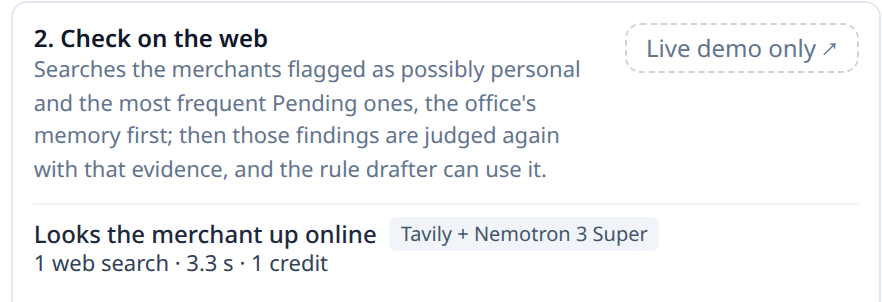

[← Back to README](../README.md)

# Tavily — how the ② verifier uses the web, and how we tested it

**In one line:** on a real book, Tavily + Nemotron Super identify the merchant's business correctly **19–20 times out of 23** (14 with our keyword table), no search ever carried a person's name, and the second review spends **0 credits**.

## Summary

To know whether an expense belongs to the business, sometimes you need to know what the merchant is. The ② verifier
looks it up on **Tavily** at review time, and **Nemotron Super** reads the results and picks the business type from a
list of 30: so the reviewer can say *"this is a gym booked as an office expense"*. It searches only what is suspicious
and **never people**, and web text cannot give orders to anyone: a single model reads it, and that model can only return
a type. On the real book, Super got **19–20 merchants right against 14** for our keyword table. And it spends little: a
new office uses **33–35 credits** on its first review and **0** on the second, because it remembers every merchant.

*A real search, as the Audit tab shows it: the review that built the guided tour searched 1 merchant on Tavily (3.3 s, 1 credit); the rest came from the office's memory.*

> **ContaBu's agents, by number.** ① **Reviewer:** judges each of the auditor's findings (a problem, or legitimate?) ·
> ② **Verifier:** looks the merchant up on the web with Tavily and says what kind of business it is · ③ **Reconciler:**
> under construction · ④ **Rule drafter:** proposes rules for what is Pending · ⑤ **Personal?:** flags expenses that look
> like the owner's personal spending, for *this* business · ⑥ **Note translator:** turns a bookkeeper's note into a check
> the auditor runs on every review. Each one's model, and why, in [Technological Implementation](technological-implementation.md).

---

## 1. What it does

- **Where it runs:** in *Review the book*, on the merchants of findings that could be personal spending (mostly the ones
  the ⑤ flagged) and on the **10 merchants with the most Pending transactions**, so the ④ drafter has evidence for what no
  rule covers. Also on demand, with *Search this merchant*, from a finding or from a transaction's panel. Mechanical
  problems (a row outside its rule, money that came in booked as an expense) are not searched: the web does not solve
  them.
- **Why only search:** the verifier needs a short, ranked list of what a merchant is, not a page's full text or a
  crawl of a site, so we use Tavily's search alone. The next step, for merchants that share a name with another
  business, is to ask the search for the book's own region (see the limits below).
- **How it searches:** a **basic** search first (1 credit). If the confidence is not high, an **advanced** one (2
  credits), once, keeping the advanced answer.
- **How it classifies:** Nemotron Super, without reasoning, receives the query, the book's region and the 5 trimmed
  results, and returns the business type, the confidence, which result it used, and whether that result is about
  **this** merchant. If the model fails or leaves the schema, the keyword table classifies.
- **It remembers:** each merchant is searched once per office; the second review comes from memory and spends no
  credits. Every search and every classification is logged, with what it cost.

## 2. What it never does

- **It never searches people.** Before every search, code drops payments between people (Zelle, Venmo, Cash App…),
  checks, transfers, card payments, bank fees, incoming money and any query that contains the name of a person from the
  book.
- **It never sends the full description or an amount:** the query is a short phrase with the merchant's name, built by
  code.
- **It never lets web text give orders.** The text of the results reaches a single model, the classifier, with four
  defenses: (1) it can only return **one type from the closed list**, or none; (2) in **strict JSON**; (3) **with no
  tools**: it cannot search, write or call anything; (4) the prompt states that the results are data, never instructions.
  Code has the last word on the answer: if the model says the result is about another merchant with the same name, or
  cites a result that does not exist, the confidence drops and nobody uses it. The other agents never see the web text:
  they receive only the type and the confidence.

## 3. The search: how we tested it

We used the three demo books, with a **key of types written before searching**: 44 merchants with their business type,
7 with no type and 4 ambiguous. Each merchant was searched **with both searches, twice**. One of the three books was
used to tune the keyword table, so it **does not count as a test**: the results are from the other two. These figures
were measured with the keyword table, before Super classified; they serve to choose how to search.

**Is it right when it says "high"?**

| Search | High confidence | Medium confidence | Low confidence |
|---|---|---|---|
| Basic | **40 of 44** | 2 of 8 | 8 of 14 |
| Advanced | **44 of 50** | 6 of 8 | 4 of 8 |

**Which way to search pays off?**

| Policy | Correct | Wrong evidence that reaches the agents | Credits |
|---|---|---|---|
| Basic only | 52 of 68 | 10 | 106 |
| Basic, then advanced if not high, keeping the better | 52 of 68 | 12 | 202 |
| **Basic, then advanced if not high, keeping the advanced (today's)** | **56 of 68** | **8** | **202** |
| Advanced only | 56 of 68 | 8 | 212 |

**Does it help the team?** With live search, the team found the same errors as with the saved evidence (29 and 31 of 32
live; 31 and 31 saved), and the verifier contributed the right correction on **4** errors in each run, against 2 with
the saved evidence.

## 4. The classification: the keyword table against the Nemotron models

**The question.** On the **same raw results** from Tavily, what classifies the business type better: the keyword table
or a Nemotron model?

**The method.** The raw results were fetched **only once** and saved (186 credits): 37 demo merchants, from the two books
not used to tune the table, and 25 merchants from the real book (2026), with basic and advanced search. After that, zero
credits: the table and the **10 candidates** (the five Nemotron models, with and without reasoning) read exactly the
same thing, **3 times each**. 33 demo merchants and 23 real-book merchants were scored (the ambiguous ones do not count),
with today's search policy. We counted what the agents actually use: the high- or medium-confidence answers, right and
wrong. **The rule, written before running:** a model is adopted only if, on both keys, it has more usable right answers
than the table and no more wrong ones.

**The real book's key, and why 4 of its rows were corrected.** The key says, for each merchant in the real book, what
kind of business it is; the book's bookkeeper wrote it **before seeing any search**. Then two things about the verifier
changed: the list of types gained a new one, *government and taxes*, and the search for a merchant named like its city
switched to searching the merchant, not the city. With those two changes, 4 answers in the key went stale, and we
corrected them using what the bookkeeper had written in each row's comment:
- 3 merchants they had left "with no type", whose comments said *taxes*, *vehicle registration* and *licenses and
  permits*, move to *government and taxes*.
- The merchant named like its city moves to *hardware store*, which is what it is.

Each correction was logged with what it said before and why it changed.

**Result** (usable answers, right · wrong, 3 runs):

| Classifier | Demo (33) | Real book, corrected key (23) |
|---|---|---|
| Keyword table | 25 · 4 | 14 · 2 |
| **Nemotron Super, no reasoning (adopted)** | **25–26 · 3–4** | **19–20 · 2** |
| Nemotron 3.5 Super VL, no reasoning | 25 · 6 | 22 · 1 |
| Nemotron 3.5 Super VL, reasoning | 22–24 · 3–5 | 21–22 · 0 |

The other seven candidates (Nano, 3.5 Lightning and Ultra, with and without reasoning, and Super with reasoning) were
measured the same way, with the key before the correction, and none beat Super on the demo without making more errors.

**The decision.** The rule written beforehand **was not met**: on the demo, Super's worst run (25) ties the table. We
adopted it because **in no run, on neither key, was it worse than the table**, and on the real book, which the table
never saw, it beats it by 5–6 right answers with the same errors. The tie on the demo is explained by the table having
been tuned on the demo's results: it plays at home there. 3.5 Super VL gets more right on the real book, but on the demo
it makes 6 usable errors against the table's 4; that is why it was not chosen. The classifier costs **$0.0004 and one
second per merchant**.

**Credits with Super.** The advanced search is only requested if the basic one's confidence is not high, so the
classifier decides how many credits are spent. Computed on the saved results (0 credits), with today's search policy:

| Merchants | With the keyword table | With Super | Fewer with Super |
|---|---|---|---|
| The 37 demo merchants | 73 | 49–53 | 27–33% |
| The 25 real-book merchants | 53 | 29–35 | 34–45% |

Super spends less because it answers "high" more often on the basic search and uses the advanced one less.

## 5. The real book (2026)

- **Credits per review** (measured with the keyword table): the first *Review the book* searches 9 merchants, all flagged
  by the audit, and spends **21 credits**; the second, with the office's memory, **0**. The same in both runs. With
  Super, on the saved results for the real book's 25 merchants, the count drops from 53 to 29–35 credits (§4).
- **Repeatable:** the 2 repetitions of the search gave exactly the same answer in all 50 cases (merchant × search type).
- **Privacy, measured on what was sent:** **0 queries with a person's name and 0 equal to the full bank line**, in the 100
  test searches and the 30 review searches. Only the query and the business's region (its city and state) go to the
  classifier.

## 6. In the demo

- A new office with the three books spends **33–35 credits** on its first review (measured with the keyword table); the
  second, **0**. With Super, on the saved results for the demo's 37 merchants, the count drops from 73 to 49–53 credits
  (§4).
- So the demo does not spend on every visitor, the evidence for its books was fetched once and is copied into each office,
  except for **three merchants left out on purpose**: an evaluator's first review makes real Tavily searches, and the
  verify step says how many were live and what they cost.

## 7. With and without Tavily

The same exams, the same code and the same day, three runs each: the whole team with the ② verifier on, and with it
off (no searches and an empty memory, so no agent receives a merchant type from the web). The script is
`backend/no_web_matrix.py`; it does not change the product or the measured files.

| Three runs each | With Tavily | Without Tavily |
|---|---|---|
| Real book: hidden errors found (of 12) | 7 · 7 · 7 | **12 · 12 · 12** |
| Real book: other purchases flagged as personal (not in the key, unchecked) | 5 · 5 · 8 | 12 · 12 · 13 |
| Demo, blind exam (of 22) | **15 · 14 · 13** | 11 · 14 · 14 |
| Demo, first exam (of 32) | 32 · 31 · 29 | 30 · 32 · 31 |
| Demo: false alarms of the ⑤ | 2 · 2 · 2 | 2 · 4 · 2 |
| Demo: Pending transactions covered by correct proposed rules (of 91) | **44** · 44 · 44 | 42 · 42 · 42 |
| Sent to the model: descriptions · amounts · names | 0 · 0 · 0 | 0 · 0 · 0 |

- **On the demo, Tavily helps a little:** the blind exam gives 13–15 against 11–14, and 2 more Pending transactions get a
  correct rule, because web evidence is one of the grounds a rule needs.
- **On the real book, it costs recall:** without the web, the ⑤ flags all 12 hidden errors, but also twice as many other
  purchases (12–13 against 5–8). Nobody labeled those, so we cannot say how many are real personal spending and how many
  are false alarms.
- **Why:** with the web, a correct store type ("department store", "supermarket") leads the ⑤ to read a personal purchase
  as a business one: the type says what the store is, not what was bought. The fix is in the limits below; until it is
  measured, ContaBu keeps the verifier on, for the evidence it puts next to each finding and the rules it grounds.

## 8. Limits, and how we will address them

| Limit | How we will address it |
|---|---|
| Small samples: 33 demo merchants and 23 from the real book | More authorized real books, each with its key written before searching |
| A correct store type does not say what was bought: with "department store" or "supermarket", the ⑤ downgraded 2 planted personal purchases in the demo, and on the real book it finds 7 of 12 with the web against 12 without (§7) | Stop the ⑤ from taking a store type as proof that the purchase is for the business, and label the extra alerts to measure its precision |
| A merchant with the same name as another business can bring the other one's evidence | Ask the search for the book's own region, besides having the classifier flag it |
| The demo's saved evidence was classified with the keyword table; in the public demo, Super classifies only the live merchants and manual searches | Re-classify that evidence with Super and re-measure the demo exams |
| The search policy was chosen with the keyword table; on the real book, *advanced only* was as accurate, made fewer errors (6 against 8) and spent less (100 against 118 credits) | Repeat that comparison with Super classifying and adopt the winner |
